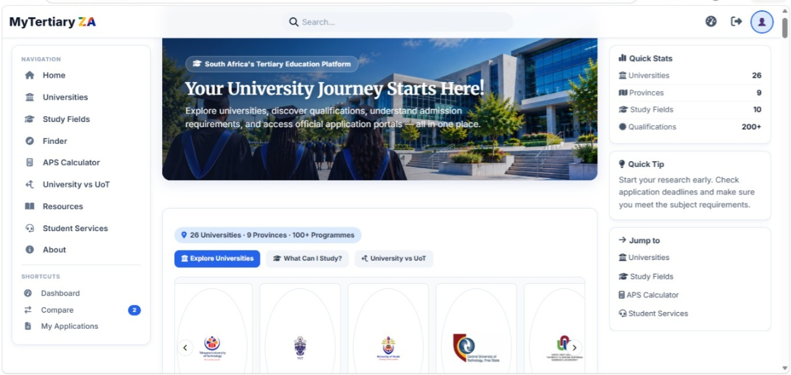
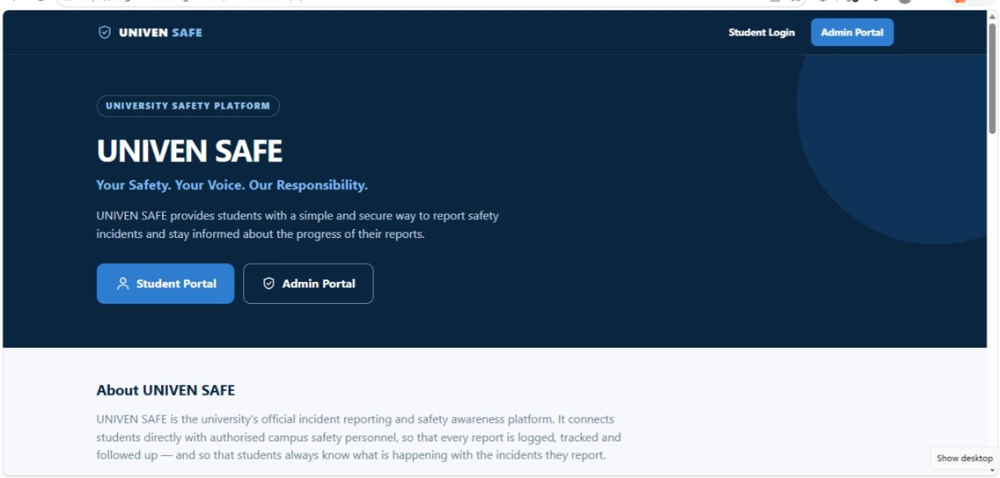
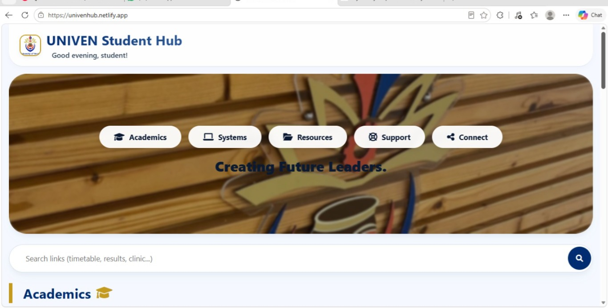
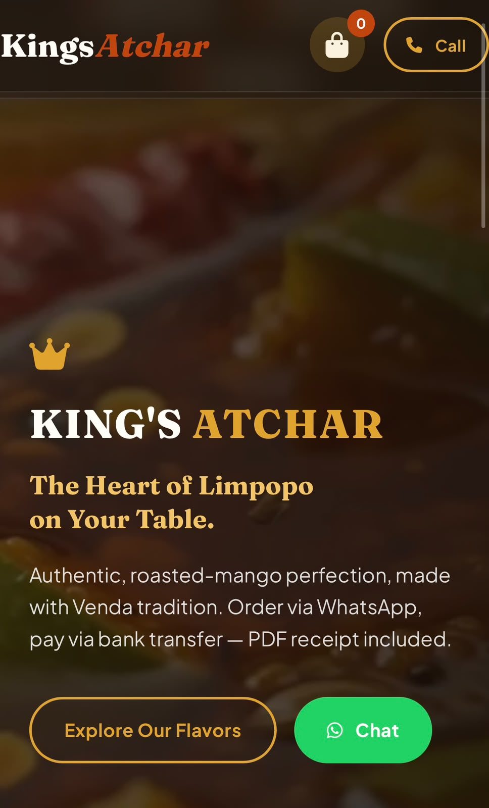

  

  Turning ideas into applications, one project at a time.

⸻

<h2 align="center">Featured Projects</h2>

A selection of projects I've built and contributed to.

<table>
<tr>
<td width="50%" valign="top">
<h3 align="center">MyTertiary ZA</h3>

A South African tertiary education platform helping students explore universities and educational opportunities.

<a href="https://mytertiaryza.co.za">View Live Website</a>

</td>
<td width="50%" valign="top">
<h3 align="center">UNIVEN Safe</h3>

A campus safety project designed to support student incident reporting and access to assistance.

<a href="https://siaga-h-mulalo.github.io/UNIVEN-SAFE/">Live Demo</a> ·
<a href="https://github.com/Siaga-h-mulalo/UNIVEN-SAFE">Source Code</a>

</td>
</tr>
<tr>
<td width="50%" valign="top">
<h3 align="center">UNIVEN-HUB PWA</h3>

A progressive web application project focused on university students.

<a href="https://univenhub.netlify.app">View Live Website</a>

</td>
<td width="50%" valign="top">
<h3 align="center">Kings Atchar</h3>

A web project for an online food business.

<a href="https://kingsatchar.netlify.app">View Live Website</a>

</td>
</tr>
</table>

  

Hi, I’m Mulalo Siaga

Computer Science Student at UNIVEN | Software Developer | Founder & Developer

I am a Computer Science student at the University of Venda (UNIVEN), passionate about software engineering, problem-solving, and building technology that solves real-world problems.

My journey is driven by continuous learning, innovation, and the ambition to become a skilled software engineer.

About Me

* Studying BSc Computer Science at the University of Venda.
* Building web applications and software projects.
* Founder and developer of MyTertiary ZA.
* Interested in artificial intelligence, cybersecurity, and software engineering.
* Helping fellow students learn Java programming.
* Always learning, building, and improving.

---

## My Developer Journey

- **2025** — Began my Computer Science degree at the University of Venda (UNIVEN).
- **2025** — Participated in the UNIVEN × CSIR CyberSecureTech Hackathon.
- **2025–2026** — Built and developed projects spanning student platforms, web applications, and campus safety.
- **2026 and beyond** — Continuing to grow in software engineering, algorithms, databases, and AI.

My goal is to build useful technology, strengthen my engineering skills, and keep learning through real projects.

Tech Stack

Languages: Java, JavaScript, C++, Python

Web Development: HTML, CSS, JavaScript

Databases: MySQL, Firebase, Cloud Firestore

Tools: Git, GitHub, VS Code, NetBeans

Core Concepts: Object-Oriented Programming, Data Structures, Algorithms, Database Design

Featured Projects

MyTertiary ZA

A South African tertiary education platform designed to help students explore universities and educational opportunities.

Website: https://mytertiaryza.co.za

UNIVEN Safe

A student-focused campus safety project designed to support incident reporting and access to assistance.

Repository: https://github.com/Siaga-h-mulalo/UNIVEN-SAFE

Live Demo: https://siaga-h-mulalo.github.io/UNIVEN-SAFE/

UNIVEN-HUB PWA

A progressive web application project focused on university students.

Website: https://univenhub.netlify.app

Kings Atchar

A web project for an online food business.

Website: https://kingsatchar.netlify.app

Dragon TurboTyping

A typing game

Website : https://siaga-h-mulalo.github.io/DragonTypingMaster/

Dragon Tactics

Sports Prediction Platform

Website : https://siaga-h-mulalo.github.io/DT/

Experience

* Participated in the UNIVEN × CSIR CyberSecureTech Hackathon.
* Developed technology projects addressing real-world challenges.
* Tutor fellow students in Java programming.
* Explore software development, web technologies, and database systems.

Currently Learning

* Advanced Java and Object-Oriented Programming
* Python
* Software engineering
* Artificial intelligence and cybersecurity

My Goals

To become a highly skilled software engineer, develop impactful digital products, contribute to open-source projects, and continue growing academically and professionally.

I believe in starting from zero, learning consistently, and building something meaningful.

Connect With Me
---

<h2 align="center">Let's Connect</h2>

  
  
  
  

  
  
  
  
  
  
  
  
  
  

<table>
  <tr>
    <td width="50%">
      <h3>MyTertiary ZA</h3>
      A South African tertiary education platform connecting students with university information and educational opportunities.
        
      <a href="https://mytertiaryza.co.za">Visit Website</a>
    </td>
    <td width="50%">
      <h3>UNIVEN Safe</h3>
      A campus safety project designed to support student incident reporting and access to assistance.
        
      <a href="https://github.com/Siaga-h-mulalo/UNIVEN-SAFE">View Repository</a> |
      <a href="https://siaga-h-mulalo.github.io/UNIVEN-SAFE/">Live Demo</a>
    </td>
  </tr>
  <tr>
    <td width="50%">
      <h3>UNIVEN-HUB PWA</h3>
      A progressive web application project for university students.
        
      <a href="https://univenhub.netlify.app">Visit Website</a>
    </td>
    <td width="50%">
      <h3>Kings Atchar</h3>
      A web project for an online food business.
        
      <a href="https://kingsatchar.netlify.app">Visit Website</a>
    </td>
  </tr>
</table>

